<picture>
  <source media="(prefers-color-scheme: dark)" srcset="./assets/aurora-rift-dark.gif">
  <source media="(prefers-color-scheme: light)" srcset="./assets/aurora-rift-light.gif">
  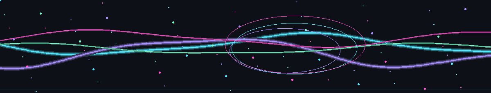
</picture>

<h1 align="center">Tejprakash Mirashi</h1>

<strong>FULL STACK AI ENGINEER</strong> &nbsp;·&nbsp; Backend Engineering &nbsp;·&nbsp; AI / ML &nbsp;·&nbsp; Distributed Systems

  <picture>
    <source media="(prefers-color-scheme: dark)" srcset="https://komarev.com/ghpvc/?username=Tejprakash25&label=PROFILE%20VIEWS&color=AA91FF&labelColor=0D1117&style=for-the-badge">
    <source media="(prefers-color-scheme: light)" srcset="https://komarev.com/ghpvc/?username=Tejprakash25&label=PROFILE%20VIEWS&color=6944D6&labelColor=FFFFFF&style=for-the-badge">
    
  </picture>

  <picture>
  <source media="(prefers-color-scheme: dark)" srcset="./assets/holographic-workstation-dark.gif">
  <source media="(prefers-color-scheme: light)" srcset="./assets/holographic-workstation-light.gif">
  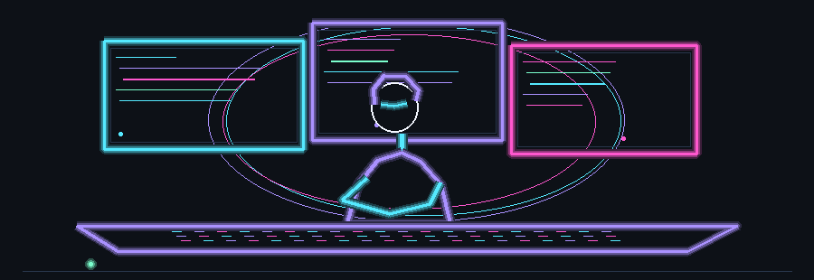
</picture>
  <picture>
  <source media="(prefers-color-scheme: dark)" srcset="./assets/neural-constellation-dark.gif">
  <source media="(prefers-color-scheme: light)" srcset="./assets/neural-constellation-light.gif">
  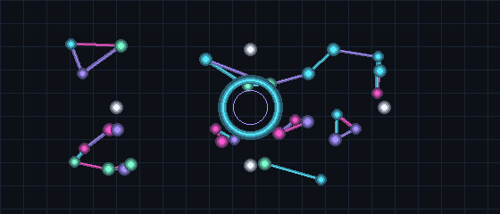
</picture>

## ABOUT

Software engineer focused on building practical intelligent systems across backend engineering, AI/ML, APIs, databases, and full-stack applications. Interested in turning complex ideas into reliable software.

## ENGINEERING SYSTEMS

  <picture>
  <source media="(prefers-color-scheme: dark)" srcset="./assets/terminal-stream-dark.gif">
  <source media="(prefers-color-scheme: light)" srcset="./assets/terminal-stream-light.gif">
  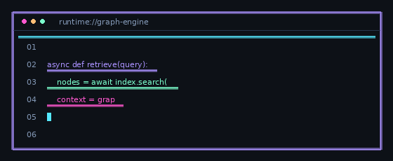
</picture>
  <picture>
  <source media="(prefers-color-scheme: dark)" srcset="./assets/language-orbit-dark.gif">
  <source media="(prefers-color-scheme: light)" srcset="./assets/language-orbit-light.gif">
  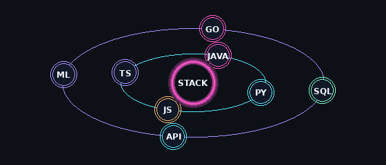
</picture>
  <picture>
  <source media="(prefers-color-scheme: dark)" srcset="./assets/backend-service-mesh-dark.gif">
  <source media="(prefers-color-scheme: light)" srcset="./assets/backend-service-mesh-light.gif">
  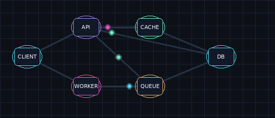
</picture>

## AI / KNOWLEDGE SYSTEMS

  <picture>
  <source media="(prefers-color-scheme: dark)" srcset="./assets/hybrid-graph-rag-dark.gif">
  <source media="(prefers-color-scheme: light)" srcset="./assets/hybrid-graph-rag-light.gif">
  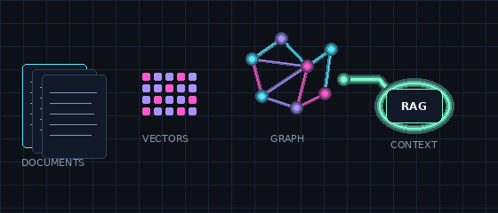
</picture>
  <picture>
  <source media="(prefers-color-scheme: dark)" srcset="./assets/neural-inference-dark.gif">
  <source media="(prefers-color-scheme: light)" srcset="./assets/neural-inference-light.gif">
  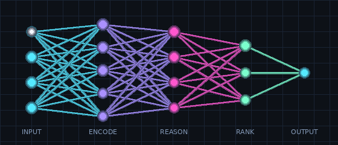
</picture>
  <picture>
  <source media="(prefers-color-scheme: dark)" srcset="./assets/data-pipeline-dark.gif">
  <source media="(prefers-color-scheme: light)" srcset="./assets/data-pipeline-light.gif">
  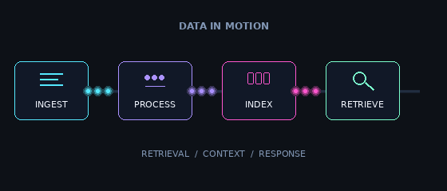
</picture>

## SHIP · DEBUG · IMPROVE

  <picture>
  <source media="(prefers-color-scheme: dark)" srcset="./assets/deployment-flow-dark.gif">
  <source media="(prefers-color-scheme: light)" srcset="./assets/deployment-flow-light.gif">
  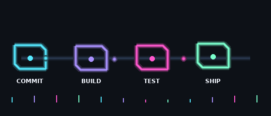
</picture>
  <picture>
  <source media="(prefers-color-scheme: dark)" srcset="./assets/debugging-lens-dark.gif">
  <source media="(prefers-color-scheme: light)" srcset="./assets/debugging-lens-light.gif">
  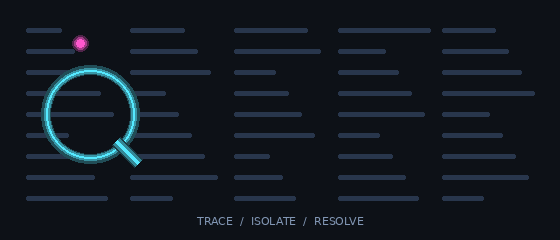
</picture>

## GITHUB STATS & TROPHIES

  <picture>
    <source media="(prefers-color-scheme: dark)" srcset="https://github-readme-stats-eight-theta.vercel.app/api?username=Tejprakash25&show_icons=true&hide_border=true&layout=compact&border_radius=10&bg_color=0D1117&title_color=55E9FF&text_color=C9D6EA&icon_color=FF57CE&cache_seconds=7200">
    <source media="(prefers-color-scheme: light)" srcset="https://github-readme-stats-eight-theta.vercel.app/api?username=Tejprakash25&show_icons=true&hide_border=true&layout=compact&border_radius=10&bg_color=FFFFFF&title_color=007F9B&text_color=46566E&icon_color=BC218D&cache_seconds=7200">
    
  </picture>
  <picture>
    <source media="(prefers-color-scheme: dark)" srcset="https://streak-stats.demolab.com/?user=Tejprakash25&hide_border=true&background=0D1117&ring=AA91FF&fire=FF57CE&currStreakLabel=55E9FF&currStreakNum=F3F7FF&sideLabels=C9D6EA&sideNums=C9D6EA&dates=8297B5">
    <source media="(prefers-color-scheme: light)" srcset="https://streak-stats.demolab.com/?user=Tejprakash25&hide_border=true&background=FFFFFF&ring=6944D6&fire=BC218D&currStreakLabel=007F9B&currStreakNum=19253A&sideLabels=46566E&sideNums=46566E&dates=64748B">
    
  </picture>

  <picture>
  <source media="(prefers-color-scheme: dark)" srcset="./assets/achievement-orbit-dark.gif">
  <source media="(prefers-color-scheme: light)" srcset="./assets/achievement-orbit-light.gif">
  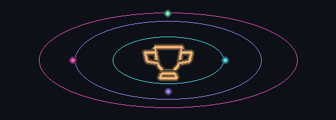
</picture>

  <picture>
    <source media="(prefers-color-scheme: dark)" srcset="https://trophy.ryglcloud.net/?username=Tejprakash25&theme=tokyonight&no-frame=true&no-bg=true&margin-w=4&cache_seconds=86400">
    <source media="(prefers-color-scheme: light)" srcset="https://trophy.ryglcloud.net/?username=Tejprakash25&theme=flat&no-frame=true&no-bg=true&margin-w=4&cache_seconds=86400">
    
  </picture>

  <picture>
    <source media="(prefers-color-scheme: dark)" srcset="https://github-readme-activity-graph.vercel.app/graph?username=Tejprakash25&bg_color=0D1117&color=C9D6EA&line=AA91FF&point=FF57CE&area=true&area_color=132B47&hide_border=true">
    <source media="(prefers-color-scheme: light)" srcset="https://github-readme-activity-graph.vercel.app/graph?username=Tejprakash25&bg_color=FFFFFF&color=46566E&line=6944D6&point=BC218D&area=true&area_color=E4F8FC&hide_border=true">
    
  </picture>

## LANGUAGES & TOOLS

<h3 align="center">Programming Languages</h3>

  
  
  
  
  
  
  
  
  

<h3 align="center">Frontend</h3>

  
  
  
  
  
  
  
  

<h3 align="center">Backend</h3>

  
  
  
  
  
  

<h3 align="center">Database</h3>

  
  
  
  
  

<h3 align="center">DevOps & Cloud</h3>

  
  
  
  
  

<h3 align="center">Tools</h3>

  
  
  
  
  
  

  <picture>
    <source media="(prefers-color-scheme: dark)" srcset="https://github-readme-stats-eight-theta.vercel.app/api/top-langs/?username=Tejprakash25&langs_count=8&layout=compact&border_radius=10&hide_border=true&bg_color=0D1117&title_color=55E9FF&text_color=C9D6EA&cache_seconds=7200">
    <source media="(prefers-color-scheme: light)" srcset="https://github-readme-stats-eight-theta.vercel.app/api/top-langs/?username=Tejprakash25&langs_count=8&layout=compact&border_radius=10&hide_border=true&bg_color=FFFFFF&title_color=007F9B&text_color=46566E&cache_seconds=7200">
    
  </picture>
  

## CONNECT

  &nbsp;
  &nbsp;
  

  <picture>
    <source media="(prefers-color-scheme: dark)" srcset="https://raw.githubusercontent.com/czl9707/gh-space-shooter/main/example.gif">
    <source media="(prefers-color-scheme: light)" srcset="https://raw.githubusercontent.com/czl9707/gh-space-shooter/main/example.gif">
    
  </picture>

